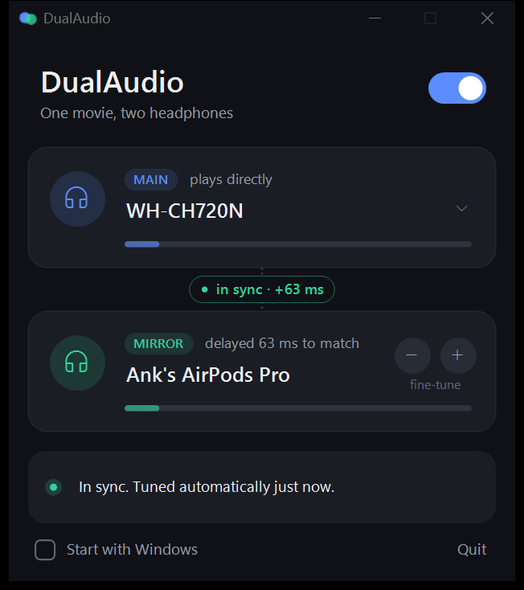

# DualAudio

**One movie, two headphones.** DualAudio plays your Windows audio on two Bluetooth headphones at the same time, in sync, with no loss of quality. Two people can watch Netflix or YouTube on one laptop, each with their own headphones, for example AirPods and a pair of Sony over-ears.

Windows can only send sound to one output device at a time. DualAudio lifts that limit with a tiny native app: a single ~290 KB `.exe`, no installer, no drivers, no runtime, about 1–2 % of one CPU core.



## Features

- **Two headphones at once.** Any two Windows outputs: Bluetooth headphones, earbuds, USB headsets, speakers.
- **Automatic sync.** Every Bluetooth headphone has its own delay (typically 150–400 ms). DualAudio measures the difference itself using the laptop's built-in microphone and a few soft chirps, then delays the faster headphone to match. It re-tunes on start, when a headphone reconnects, and whenever you press **Resync**.
- **Remembers each pair.** The measured timing is saved per headphone pair, so it is in sync immediately next time, even if you are already wearing them.
- **Swaps roles by itself.** If the second headphone turns out to be the slower one, it is made the main headphone automatically.
- **Keeps video in sync.** The main headphone is the Windows default and plays directly, so Netflix and YouTube keep their own lip-sync. The second headphone is matched to it.
- **No quality loss** (see below).
- **Stays locked.** The two Bluetooth clocks drift apart slowly. A tiny speed trim (at most 0.2 %) holds them together without clicks or dropouts.
- **Tray app.** Close the window and it keeps running in the tray. Optional *Start with Windows*.

## How it works

```
 app audio ──► Windows mixer ──► MAIN headphone (Windows default, untouched)
                     │
                     └─ loopback copy ──► delay + drift trim ──► MIRROR headphone
```

1. The Windows default output (the **main** headphone) plays exactly as it normally would. DualAudio does not process it.
2. DualAudio takes a bit-exact copy of that output using WASAPI loopback capture, the same stream Windows sends to the main headphone.
3. The copy goes through a small buffer (the sync delay) to the **mirror** headphone.
4. A control loop watches the buffer and nudges the mirror's playback speed by a few parts per million, so the two never drift apart.
5. **Calibration:** a short chirp goes through the main headphone only, then through the mirror only. The laptop mic times both arrivals against the same clock. The difference is the delay to apply. It is repeated and verified, and is typically accurate to about ±2 ms.

## Audio quality

The goal is to sound exactly like Windows does with a single headphone.

| Path | What happens to the audio |
| --- | --- |
| Main headphone | Nothing. Windows plays it directly, the same as without DualAudio. |
| Mirror headphone | A bit-exact 32-bit float copy of the Windows mix, passed through a 48-tap Kaiser-windowed sinc resampler for drift correction. If the mirror's native format differs (e.g. 44.1 kHz vs 48 kHz), Windows' own converter is used, the same one every app uses. |

Measured with `dualaudio-cli --selftest` at the speed trims the app actually uses:

| Tone | Level change | Noise and distortion below the signal |
| --- | --- | --- |
| 1 kHz | 0.00 dB | 114 dB |
| 10 kHz | 0.00 dB | 130 dB |
| 18 kHz | 0.00 dB | 103 dB |
| 20 kHz | 0.00 dB | 118 dB |

For comparison, CD audio is about 96 dB. A plain linear-interpolation resampler would lose 1–5 dB of treble above 10 kHz.

**Things that are outside DualAudio's control:**

- **Bluetooth codec.** Each headphone uses whatever codec Windows negotiates with it (SBC/AAC), exactly as when used alone.
- **Call mode.** If any app opens a Bluetooth headset's microphone, Windows drops that headphone to low-quality "hands-free" mode. DualAudio itself never does this: calibration only uses the laptop's built-in mic.
- **Radio bandwidth.** One Bluetooth radio sending two audio streams can occasionally stutter in a crowded 2.4 GHz environment. If that happens, a USB Bluetooth adapter for one of the headphones fixes it.

## How many headphones?

**Two:** the main headphone plus one mirror. The engine is written to feed several mirrors, but the app exposes one. A third Bluetooth stream on a single laptop radio is likely to stutter, so it is not offered yet.

## Usage

1. Connect both headphones to Windows.
2. Run `DualAudio.exe`. It picks the Windows default as the main headphone and the other headphone as the mirror.
3. On the first run for a new pair, lay both headphones next to the laptop for a few seconds while it tunes. After that the timing is remembered.

| Control | What it does |
| --- | --- |
| Power switch | Turns mirroring on/off |
| Main card | Choose which device plays directly (sets the Windows default) |
| Mirror card | Choose the second headphone |
| **Resync** | Measure the sync again now (lay both headphones near the laptop) |
| − / + | Optional fine-tune in 2 ms steps, saved per pair |
| Start with Windows | Launch quietly into the tray at sign-in |

## Building

Requirements: Windows 10/11 and Visual Studio 2022 (Desktop C++ workload). No third-party libraries.

```bat
build.bat
```

This produces:

- `DualAudio.exe`: the app (window + tray)
- `dualaudio-cli.exe`: a test and diagnostic tool

```bat
dualaudio-cli --list                                     :: list outputs
dualaudio-cli --target 3 --delay 60 --seconds 20         :: mirror to output 3, print stats
dualaudio-cli --target 3 --calibrate                     :: measure the sync with the laptop mic
dualaudio-cli --selftest                                 :: measure resampler audio quality
```

## Project layout

| File | Purpose |
| --- | --- |
| `engine.h` | Loopback capture, mirror playback, delay buffer, drift control |
| `resampler.h` | Windowed-sinc resampler for transparent drift correction |
| `devices.h` | Device listing and switching the Windows default output |
| `calibrate.h` | Automatic sync measurement with the laptop mic |
| `dualaudio_gui.cpp` | Window, tray icon, auto-resync logic, per-pair memory |
| `dualaudio_cli.cpp` | Command-line test tool and quality self-test |
| `build.bat` | Builds both executables with MSVC |

Settings are stored in `dualaudio.cfg` next to the exe.

## Limitations

- Bluetooth always adds some delay compared with wired audio. DualAudio keeps both headphones aligned with each other and with the main headphone's own video sync, but it cannot make Bluetooth faster.
- Automatic tuning needs the laptop mic to hear both headphones, so lay them nearby when it tunes a new pair. Known pairs reuse their saved timing.
- Protected/exclusive-mode audio that bypasses the Windows mixer cannot be mirrored.
